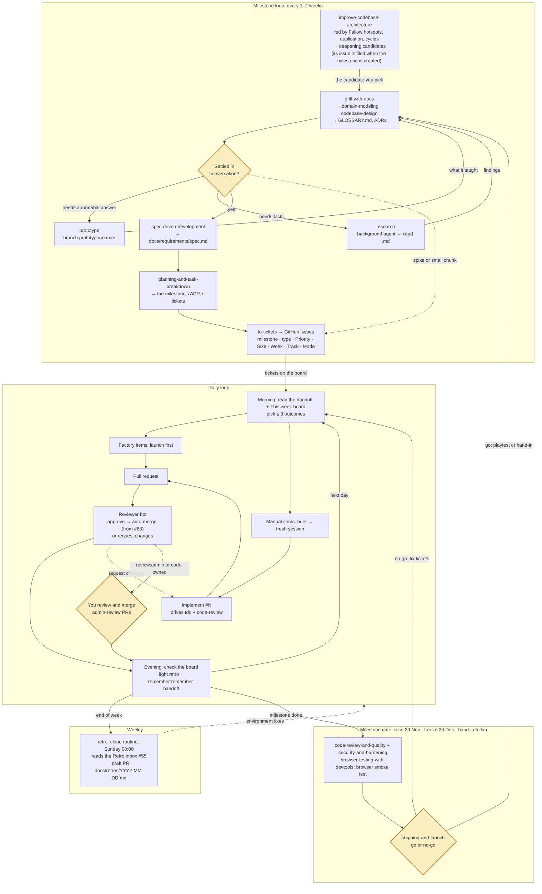

# Workflow

How work moves from an idea to merged code, and which skill runs at each step. Addy Osmani's skills
own the gates (constraints, spec, plan, review, ship). Matt Pocock's skills own the design depth and
the tracker loop (grilling, domain language, deep modules, tickets, implementation, retros). Each
job has exactly one owning skill.

Last changed: 2026-11-22 (the architecture review moves from Weekly into the milestone loop, #517).
Before that 2026-11-16 (the Wk 2 workflow audit's stale places, #273).

Every name below is a skill in `.claude/skills/`, except `remember:remember`, which comes from the
`remember` plugin, and `/today`, which is the admin's user-scoped skill (`~/.claude/skills/today/`).
`/clear` and `/compact` are built-in commands. `/today`'s stage 1 (drafting the agenda and briefs,
#117) and its coordinator mode (#157) have landed, and stage 2 is #109 (see **Automation stages**).

## The loops



Gold diamonds are your decisions.

**Reviews** (ADR-0002, area 2): PRs are reviewed the way people on GitHub review each other. A
reviewer bot reviews every PR but Dependabot's (`REVIEW.md`, "Dependabot PRs"). It either approves,
and the PR auto-merges once the required checks are green, or requests changes, and the author fixes
them and pushes. You review and merge only admin-review PRs: those that touch a code-owned path, and
those carrying `review:admin` under the escalation criteria in `CONSTRAINTS.md`, "Admin review".
Production changes only when you push a `v*` tag (ADR-0002, area 4). What every reviewer checks, how
it rates findings and how it reports is `REVIEW.md`, at the repo root, for the bot, the
coordinator's reviewer and a lane's own review alike.

**Escalation comments.** Lanes no longer write a one-line escalation comment when they add
`review:admin`; the reviewer bot's escalation is the record (retro 2026-11-15, Outcomes 5).
`CONSTRAINTS.md`, "Escalation criteria" still asks whoever adds the label to post one until #104
changes it, so until then each brief tells its lane not to write one.

**Until #68, the reviewer bot reviews but doesn't approve.** Since 12 Nov it posts a review on every
PR, but it neither approves nor turns on auto-merge: ruleset `main` stays at 0 required approvals
with last-push approval off until #264 ("Stacks: one approval pass and one CI run per stack") lands,
and #68 is blocked by #264 (retro 2026-11-15, Outcomes 1). So you merge every PR, factory PRs
included. The coordinating session dispatches a fresh-context reviewer agent per PR and relays its
verdict before you merge (the user-scoped `/today` skill, `~/.claude/skills/today/prs.md`, "Review"
and "Relay").

## When to use what

<!-- prettier-ignore -->
| When | Skill | Produces | You decide |
|---|---|---|---|
| Once, week 1 | `setup-matt-pocock-skills` (done) | `docs/agents/*.md` | tracker settings |
| | Addy `constraint-driven-development` (done, #34) | `CONSTRAINTS.md` | the quality bar |
| Start of a milestone | `grill-with-docs` (+ `domain-modeling`, `codebase-design`) | `GLOSSARY.md`, ADRs (pattern + alternatives) | every design decision |
| ↳ needs a runnable answer | `prototype` | `prototype/<name>` branch, never merged | what it taught |
| ↳ needs facts | `research` (background) | cited `.md` | nothing: it feeds the grill |
| | `improve-codebase-architecture`, fed by Fallow hotspots, duplication and cycles; its issue `Architecture review, <milestone>` is filed when the milestone is created (`.github/workflows/milestone-review.yml`, #517) | deepening candidates | which one to pick |
| | Addy `spec-driven-development` | `docs/requirements/spec.md` (living, doubles as the requirements chapter) | edit and approve |
| | Addy `planning-and-task-breakdown` | the milestone's plan as an ADR plus its tickets (M2: ADR-0003; M3 the same way, under #74); no `docs/plans/` file exists, and the week plan lives in the coordinator's `.scratch/` | approve the plan |
| | `to-tickets` | GitHub issues with native blocking edges, on the Project | nothing: it publishes |
| Daily, per ticket | `implement #N` in a fresh session (drives `tdd`, `code-review`, which runs as a self-review under `REVIEW.md`) | PR, reviewed under `REVIEW.md` by the reviewer bot (until #68, also a reviewer agent the coordinator dispatches) | review and merge admin-review PRs (every PR until #68) |
| ↳ high stakes: sim determinism, authority, RLS | Addy `doubt-driven-development` | adversarial review | |
| ↳ framework APIs: Next, Drizzle, Supabase | Addy `source-driven-development` | docs-verified code | |
| ↳ module or API shape | Addy `api-and-interface-design` + `codebase-design` | interface sketch | the interface |
| ↳ something broke | `diagnosing-bugs` | regression test + fix | |
| ↳ only the admin can do it | `wizard` | setup script; issue gets `blocked:admin` until done | |
| Weekly | `retro` (see **Weekly retro convention**), a cloud routine on Sundays at 08:00; it handles the comments in the Retro inbox #55 | a draft PR with `docs/retros/YYYY-MM-DD.md`, new checks and standards | which fixes to adopt |
| Milestone gate | Addy `code-review-and-quality` + `security-and-hardening`, `browser-testing-with-devtools`, `shipping-and-launch` | go/no-go with rollback plan | go or no-go |
| After playtests | `triage` | feedback turned into ready issues | what's worth doing |
| End of day | `remember:remember` (plugin) | handoff with the top 3 next | |

Not used, because another skill owns the job: Addy `interview-me` and `idea-refine`
(`grill-with-docs`), Matt `to-spec` (`spec-driven-development`), Addy `incremental-implementation`
(`implement`), Addy `documentation-and-adrs` (`domain-modeling`). `wayfinder` stays in reserve for
an effort too foggy for one grill.

Why `implement` owns the ticket loop (admin, 9 Nov, #55): it starts from a GitHub issue (through
`docs/agents/issue-tracker.md`), drives `tdd`, and ends with `code-review`, which checks the work
against the repo's standards and the issue's criteria. `incremental-implementation` and Addy's
`/build` start from a plan's task list instead, and `to-tickets` has already sliced the work small,
so their slicing adds nothing. The trade-off: `implement` is thin, so a large ticket may name
`incremental-implementation` under "Extra skills:". `implement` can't start itself
(`disable-model-invocation: true`), so the admin types `/implement #N` in the launch line. #112
re-evaluates this, including `/build auto` for the factory.

## Self-improving loops

The project should get harder to break over time. A mistake that happens twice is a missing
safeguard. Matt's rule decides the kind of safeguard: **mechanical mistakes become checks** (a lint
rule, a Fallow boundary, a test, a CI step), **judgement calls become standards** (a line in
`AGENTS.md` or `CONSTRAINTS.md`, a coding standard `code-review` enforces). Add the safeguard as
early as possible: the cheapest moment is the first repeat.

<!-- prettier-ignore -->
| Loop | Output of | Feeds |
|---|---|---|
| Complexity and coupling | Fallow hotspots, duplication, cycles | each milestone's `improve-codebase-architecture` candidates |
| Property failures | fast-check's shrunk counterexample | a named regression test kept next to the property |
| Repeated review findings | `code-review` flagging the same kind of issue twice | a check or a standard, via `retro` |
| Playtests | tester feedback | `triage` → `ready` issues; the next grill may reopen a MoSCoW item |
| Load tests | Locust latency and storage numbers | response-time limits in `docs/requirements/spec.md`, so later runs check against measured numbers |
| Repeated manual steps | daily routine, noted in retros | the next automation stage (`/today`, factory) |

**Weekly retro convention.** Besides "what went well and what didn't", every weekly `retro` asks:

1. Which mistakes or review findings happened more than once? Turn each into a check or a standard,
   and record which one in the retro file.
2. Which manual steps did I repeat? Note each one with its count toward the 3-repetition rule.
3. Which tool output isn't feeding anything yet? Propose the loop that would use it.

Each answer becomes an issue or a direct change in the same week, never only a note.

During the week, notes for the retro go to the **Retro inbox** (#55) as comments; the retro handles
each one (#79 closed, retro 2026-11-15, Outcomes 8). The retro itself is to become a module of the
agent-workflow package, not yet specified (same Outcomes item).

## Daily routine (Stage 0)

Morning, about 10 minutes:

1. Read the handoff the session starts with.
2. Open the **This week** board. Pick at most 3 outcomes (usually 1 design and 1–2 build) and move
   them to **Ready**. Ready is your focus; everything else stays in Backlog.
3. Launch Factory items first, so agents work while you design.
4. For each Manual item, write a brief (`/today` drafts them into `.scratch/`; its full shape is in
   the user-scoped skill's `~/.claude/skills/today/dispatch.md`, "The unattended brief") and open a
   fresh session in the repo with the launch line `/implement #N Read and follow <brief> first.` The
   brief, in short:

   ```
   Build lane: #N "<title>" (<milestone>, <week>, <priority>, under #<parent>).
   Before the first edit, enter your own worktree as .claude/worktrees/<N>-<slug>
   (a cloud lane has no worktree step: it works on its own branch).
   Read first: <the issue's criteria, the docs and the sections that matter>.
   Skills: /implement #N drives tdd and ends with code-review, run as a self-review under REVIEW.md.
   Extra skills: <the ↳ rows of "When to use what" that fit, or "none">.
   Decided: <settled points, with links>.
   Things to know: <code-owned paths, review:admin rows, area label, other lanes on the same files>.
   Deliverable: <one PR or a stack; the checks to run; PR number, head SHA, "close #N?">.
   ```

   Only for an issue that changes admin-owned paths such as `tests/acceptance/**` (#385; ADR-0007,
   "Acceptance tests"), Things to know adds: "Open the PR with `scripts/open-pr.sh --as-admin` (a
   stack: `scripts/stack.sh open --as-admin`), so the admin is its author. It works only on a run
   the admin launched with `OPEN_PR_AS_ADMIN=<N>`; never set it yourself. The script adds the line
   saying a lane opened it." The launch line is then
   `OPEN_PR_AS_ADMIN=<N> claude "/implement #N Read and follow <brief> first."`; for a cloud lane,
   the variable goes in the environment's settings for that run and is removed after.

During the day, at each phase boundary choose, in this order: continue · subagent · `/clear` ·
`/compact` · `handoff` (only for a new directory, harness or mid-phase side task).

**Parallel sessions.** One folder can only have one branch checked out, so two sessions in the same
folder change each other's files underneath them. The main folder stays on `main` for the
coordinating session; every work session gets its own git worktree under `.claude/worktrees/` (the
session's worktree tool creates one on a new branch from `origin/main`).

- Each worktree needs its own `pnpm install` once the repo has dependencies. The pnpm store is
  shared, so it's fast.
- The local Supabase stack is one per machine and shared by every worktree.
- Most git commands (worktrees, commits, pushes) run inside the sandbox. The exceptions are in
  `docs/agents/sandbox.md`, "Git inside the sandbox" and "When git does need the host".
- **Cloud lanes** (claude.ai/code sessions) run in their own container on their own branch, so they
  have no worktree step and nothing to tidy locally: `scripts/after-merge.sh` only removes local
  worktrees and their branches, and GitHub deletes a merged head branch itself. They reach GitHub
  over REST only (`gh api repos/…`, no GraphQL), so they build stacks with `scripts/stack.sh`, which
  needs nothing else (#264).

**Stacks.** A PR over the split size becomes a stack, as `CONSTRAINTS.md`, "Split size" sets out
today: `Part of #N` on every part but the last, `Closes #N` on the last, and what a lane does after
a lower part merges. Read the rule there; this is only a pointer. Every lane, cloud or local, opens
and keeps its stack with `scripts/stack.sh` (#264), never with hand-chained bases.

Evening, about 10 minutes. This routine stays manual, with no schedule: it needs local state (the
worktrees, the handoff), which a cloud routine can't see.

1. Check the board: the Status moves itself (`docs/agents/issue-tracker.md`, "Status rules"), so fix
   only a status that's wrong, and set `blocked:*` labels with their reason. Before giving you a
   closing PR's verdict, the coordinator ticks the acceptance criteria its reviewer confirmed
   (`docs/agents/issue-tracker.md`, "Checkboxes"). `scripts/missing-fields.sh` and
   `scripts/orphan-issues.sh` list the open issues missing a field or a parent (`issue-tracker.md`,
   "Issue fields" and "Grouping").
2. A light `retro` if you built something. Note any step you repeated by hand.
3. Tidy up after the PRs that merged: check `git worktree list`, then from the main folder run
   `scripts/after-merge.sh <name>` for each (it fast-forwards main, removes the worktree and deletes
   the branch). If it exits 3, run the command it prints outside the sandbox; see
   `docs/agents/sandbox.md`, "When git does need the host". A cloud lane's branch isn't a local
   worktree, so the script doesn't reach it; GitHub deletes it at merge (the repo's "Automatically
   delete head branches").
4. `remember:remember` handoff with the top 3 next.

At merge, a required check that is red on a change you approved (for example `guard / floor` on an
intended `CONSTRAINTS.md` edit) is yours to lift: the PR says so in its Concerns, and you lift
`main checks` for that one merge. Agents never bypass a ruleset (`AGENTS.md`).

## Automation stages

<!-- prettier-ignore -->
| Stage | When | What runs |
|---|---|---|
| 0 | now | Everything above, by hand. Note repeated steps in each retro. |
| 1 | landed 9 Nov (#117), coordinator mode 11 Nov (#157) | Read-only `/today`: handoff + this week's board → agenda, a brief per Manual item, a prompt per Factory item; then coordinator mode for the rest of the day. |
| 2 | ~week 4 (#109) | Billetto-style gather script, background review agents, action batch, check every ~75 min, `/today wrap`. |

Automate a step only after doing it by hand 3 times with the same result.
