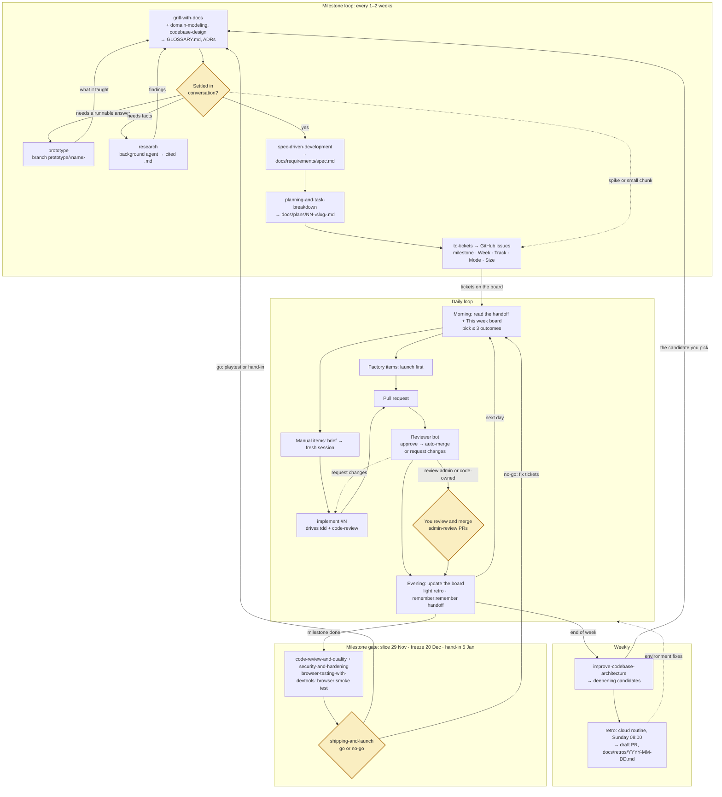

# Workflow

How work moves from an idea to merged code, and which skill runs at each step. Addy Osmani's skills
own the gates (constraints, spec, plan, review, ship). Matt Pocock's skills own the design depth and
the tracker loop (grilling, domain language, deep modules, tickets, implementation, retros). Each
job has exactly one owning skill.

Last changed: 2026-11-12 (`REVIEW.md` as the one review standard, #225). Before that 2026-11-08
(reviewer-bot model from ADR-0002, area 2; weekly retro as a Sunday cloud routine; #53).

Every name below is a skill in `.claude/skills/`, except `remember:remember`, which comes from the
`remember` plugin. `/clear` and `/compact` are built-in commands, and `/today` is a planned command
(see **Automation stages**).

## The loops



Gold diamonds are your decisions.

**Reviews** (ADR-0002, area 2): PRs are reviewed the way people on GitHub review each other. A
reviewer bot reviews every PR. It either approves, and the PR auto-merges once the required checks
are green, or requests changes, and the author fixes them and pushes. You review and merge only
admin-review PRs: those that touch a code-owned path, and those carrying `review:admin` under the
escalation criteria in `CONSTRAINTS.md`, "Admin review". Production changes only when you push a
`v*` tag (ADR-0002, area 4). What every reviewer checks, how it rates findings and how it reports is
`REVIEW.md`, at the repo root, for the bot, the coordinator's reviewer and a lane's own review
alike.

**Until #68, the reviewer bot isn't live** (it needs #37 and #68), so you review and merge every PR,
factory PRs included. Until then the coordinating session stands in for the bot: it dispatches a
fresh-context reviewer agent per PR and relays the verdict before you merge
(`.claude/skills/today/SKILL.md`, "After the agenda: coordinator mode").

## When to use what

| When                                           | Skill                                                                                                             | Produces                                                                                                    | You decide                                             |
| ---------------------------------------------- | ----------------------------------------------------------------------------------------------------------------- | ----------------------------------------------------------------------------------------------------------- | ------------------------------------------------------ |
| Once, week 1                                   | `setup-matt-pocock-skills` (done)                                                                                 | `docs/agents/*.md`                                                                                          | tracker settings                                       |
|                                                | Addy `constraint-driven-development` (done, #34)                                                                  | `CONSTRAINTS.md`                                                                                            | the quality bar                                        |
| Start of a milestone                           | `grill-with-docs` (+ `domain-modeling`, `codebase-design`)                                                        | `GLOSSARY.md`, ADRs (pattern + alternatives)                                                                | every design decision                                  |
| ↳ needs a runnable answer                      | `prototype`                                                                                                       | `prototype/<name>` branch, never merged                                                                     | what it taught                                         |
| ↳ needs facts                                  | `research` (background)                                                                                           | cited `.md`                                                                                                 | nothing: it feeds the grill                            |
|                                                | Addy `spec-driven-development`                                                                                    | `docs/requirements/spec.md` (living, doubles as the requirements chapter)                                   | edit and approve                                       |
|                                                | Addy `planning-and-task-breakdown`                                                                                | `docs/plans/NN-<slug>.md`, frozen once published                                                            | approve the plan                                       |
|                                                | `to-tickets`                                                                                                      | GitHub issues with native blocking edges, on the Project                                                    | nothing: it publishes                                  |
| Daily, per ticket                              | `implement #N` in a fresh session (drives `tdd`, `code-review`, which runs as a self-review under `REVIEW.md`)    | PR, reviewed under `REVIEW.md` by the reviewer bot (until #68, a reviewer agent the coordinator dispatches) | review and merge admin-review PRs (every PR until #68) |
| ↳ high stakes: sim determinism, authority, RLS | Addy `doubt-driven-development`                                                                                   | adversarial review                                                                                          |                                                        |
| ↳ framework APIs: Next, Drizzle, Supabase      | Addy `source-driven-development`                                                                                  | docs-verified code                                                                                          |                                                        |
| ↳ module or API shape                          | Addy `api-and-interface-design` + `codebase-design`                                                               | interface sketch                                                                                            | the interface                                          |
| ↳ something broke                              | `diagnosing-bugs`                                                                                                 | regression test + fix                                                                                       |                                                        |
| ↳ only the admin can do it                     | `wizard`                                                                                                          | setup script; issue gets `blocked:admin` until done                                                         |                                                        |
| Weekly                                         | `improve-codebase-architecture`                                                                                   | deepening candidates                                                                                        | which one to pick                                      |
|                                                | `retro` (see **Weekly retro convention**), a cloud routine on Sundays at 08:00                                    | a draft PR with `docs/retros/YYYY-MM-DD.md`, new checks and standards                                       | which fixes to adopt                                   |
| Milestone gate                                 | Addy `code-review-and-quality` + `security-and-hardening`, `browser-testing-with-devtools`, `shipping-and-launch` | go/no-go with rollback plan                                                                                 | go or no-go                                            |
| After playtests                                | `triage`                                                                                                          | feedback turned into ready issues                                                                           | what's worth doing                                     |
| End of day                                     | `remember:remember` (plugin)                                                                                      | handoff with the top 3 next                                                                                 |                                                        |

Not used, because another skill owns the job: Addy `interview-me` and `idea-refine`
(`grill-with-docs`), Matt `to-spec` (`spec-driven-development`), Addy `incremental-implementation`
(`implement`), Addy `documentation-and-adrs` (`domain-modeling`). `wayfinder` stays in reserve for
an effort too foggy for one grill.

## Self-improving loops

The project should get harder to break over time. A mistake that happens twice is a missing
safeguard. Matt's rule decides the kind of safeguard: **mechanical mistakes become checks** (a lint
rule, a Fallow boundary, a test, a CI step), **judgement calls become standards** (a line in
`AGENTS.md` or `CONSTRAINTS.md`, a coding standard `code-review` enforces). Add the safeguard as
early as possible: the cheapest moment is the first repeat.

| Loop                     | Output of                                           | Feeds                                                                                             |
| ------------------------ | --------------------------------------------------- | ------------------------------------------------------------------------------------------------- |
| Complexity and coupling  | Fallow hotspots, duplication, cycles                | weekly `improve-codebase-architecture` candidates                                                 |
| Property failures        | fast-check's shrunk counterexample                  | a named regression test kept next to the property                                                 |
| Repeated review findings | `code-review` flagging the same kind of issue twice | a check or a standard, via `retro`                                                                |
| Playtests                | tester feedback                                     | `triage` → `ready` issues; the next grill may reopen a MoSCoW item                                |
| Load tests               | Locust latency and storage numbers                  | response-time limits in `docs/requirements/spec.md`, so later runs check against measured numbers |
| Repeated manual steps    | daily routine, noted in retros                      | the next automation stage (`/today`, factory)                                                     |

**Weekly retro convention.** Besides "what went well and what didn't", every weekly `retro` asks:

1. Which mistakes or review findings happened more than once? Turn each into a check or a standard,
   and record which one in the retro file.
2. Which manual steps did I repeat? Note each one with its count toward the 3-repetition rule.
3. Which tool output isn't feeding anything yet? Propose the loop that would use it.

Each answer becomes an issue or a direct change in the same week, never only a note.

## Daily routine (Stage 0)

Morning, about 10 minutes:

1. Read the handoff the session starts with.
2. Open the **This week** board. Pick at most 3 outcomes (usually 1 design and 1–2 build) and move
   them to **Ready**. Ready is your focus; everything else stays in Backlog.
3. Launch Factory items first, so agents work while you design.
4. For each Manual item, write a brief and open a fresh session in the repo:

   ```
   Work in a worktree named <N>-<slug>.
   Work on #N: <one-line goal>.
   Read first: <files, ADRs, links>.
   Decided: <settled points, with links>.
   Start with: <skill>.
   Report back: <PR link, check output, open questions>.
   ```

During the day, at each phase boundary choose, in this order: continue · subagent · `/clear` ·
`/compact` · `handoff` (only for a new directory, harness or mid-phase side task).

**Parallel sessions.** One folder can only have one branch checked out, so two sessions in the same
folder change each other's files underneath them. The main folder stays on `main` for the
coordinating session; every work session gets its own git worktree under `.claude/worktrees/` (the
session's worktree tool creates one on a new branch from `origin/main`).

- Each worktree needs its own `pnpm install` once the repo has dependencies. The pnpm store is
  shared, so it's fast.
- The local Supabase stack is one per machine and shared by every worktree.
- Most git commands (worktrees, commits, pushes) run inside the sandbox. The exceptions are in
  `docs/agents/sandbox.md`, "Git inside the sandbox" and "When git does need the host".

Evening, about 10 minutes. This routine stays manual, with no schedule: it needs local state (the
worktrees, the handoff), which a cloud routine can't see.

1. Update the board: statuses, `blocked:*` labels with their reason.
2. A light `retro` if you built something. Note any step you repeated by hand.
3. Tidy up after the PRs that merged: check `git worktree list`, then from the main folder run
   `scripts/after-merge.sh <name>` for each (it fast-forwards main, removes the worktree and deletes
   the branch). If it exits 3, run the command it prints outside the sandbox; see
   `docs/agents/sandbox.md`, "When git does need the host".
4. `remember:remember` handoff with the top 3 next.

## Automation stages

| Stage | When    | What runs                                                                                                            |
| ----- | ------- | -------------------------------------------------------------------------------------------------------------------- |
| 0     | now     | Everything above, by hand. Note repeated steps in each retro.                                                        |
| 1     | ~week 2 | Read-only `/today`: handoff + this week's board → brief, agenda, a brief per Manual item, a prompt per Factory item. |
| 2     | ~week 3 | Billetto-style gather script, background review agents, action batch, check every ~75 min, `/today wrap`.            |

Automate a step only after doing it by hand 3 times with the same result.
