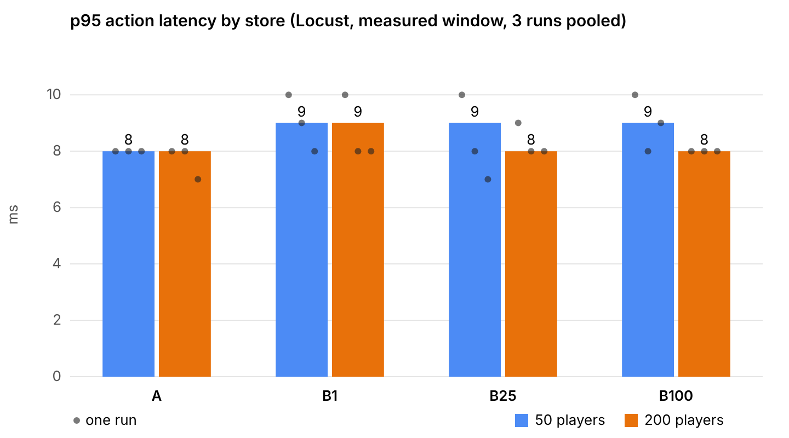

# Persistence spike: load matrix results (#11)

ADR-0001's load matrix, run on 6 Nov 2026 from 17:37 to 20:30 UTC in the Claude cloud load
environment (#15), in one session with no interruption. All 24 normal configurations and the
4 stress runs finished, before any timebox cut-off, so **all three runs per configuration count**.
Raw data: one folder per configuration in [`matrix/`](matrix/README.md) (Locust CSVs and JSON,
the server's per-request CSV, seed and storage reports). One row per configuration:
[`results.csv`](results.csv). Generated by `prototypes/persistence/load/results.py`; the chart is
its `chart.svg`, rendered to `chart.png` with the image's Chromium.

## Machine (`matrix/machine.json`)

| | |
| --- | --- |
| Postgres | **17.11** (PGDG, `17.11-1.pgdg24.04+2`), default configuration, 127.0.0.1:5432 |
| CPU | Intel(R) Xeon(R) Processor @ 2.10GHz, 4 vCPUs |
| RAM | 16 GiB |
| OS | Ubuntu 24.04.5 LTS (Firecracker microVM, kernel 6.18.44) |
| Node / Python / Locust | v24.22.1 / 3.13.18 / 2.47.0 |

Locust, the spike server and Postgres share the VM (ADR-0001 "Method"). Before the matrix, the
gate passed again in this session on Postgres 17.11: hash `e1925b02…` at seq 456 in every store,
456/456 strict round trips, `stateAt` 11/11 for every B.

## Results

| | A | B1 | B25 | B100 |
| --- | --- | --- | --- | --- |
| Gate (hash equivalence) | pass | pass | pass | pass |
| p50 / p95 at 50 players (ms) | 5 / 8 | 6 / 9 | 6 / 9 | 6 / 9 |
| p50 / p95 at 200 players (ms) | 5 / 8 | 6 / 9 | 6 / 8 | 6 / 8 |
| p95 per run at 200 players (ms) | 8, 8, 7 | 10, 8, 8 | 9, 8, 8 | 8, 8, 8 |
| Server-side action p95 at 200 players, mean of runs (ms) | 5.08 | 6.06 | 5.62 | 5.42 |
| Worst-case load p95 (ms) | n/a | n/a | n/a | 2.46 (n = 635) |
| Offline return p95 at 50 / 200 (ms) | 4 / 4 | 5 / 5 | 5 / 5 | 6 / 5 |
| Lost updates / retries / 503s | 0 / 0 / 0 | 0 / 0 / 0 | 0 / 0 / 0 | 0 / 0 / 0 |
| Bytes per player-hour at 50 / 200 | 146,364 / 139,264 | 209,715 / 201,114 | 226,645 / 208,350 | 216,269 / 200,704 |
| Read / write share | 49.6% / 50.4% | 49.6% / 50.4% | 49.7% / 50.3% | 49.3% / 50.7% |
| `stateAt` possible | no | yes | yes | yes |
| Lines / moving parts | 94 code lines; `farms` + `processed_keys` | 129 code lines (B1, B25 and B100 share them); `actions` + `snapshots`, plus the injected `replay` | same | same |

Every normal configuration: 0 Locust failures, 0 422s. At 200 players the matrix offers about
37 requests/s (9 at 50 players); p99 is 10–13 ms in every configuration.

## Decision rule, applied mechanically

1. **Gate:** passed for every store (above, and [`gate.md`](gate.md)).
2. **B wins unless** a B variant fails a condition. A's p95 at 200 players is 8 ms, so the limit
   is max(2 × 8, 8 + 20) = **28 ms**.
   - B1: p95 9 ms ≤ 28 ms. Passes.
   - B25: p95 8 ms ≤ 28 ms. Passes.
   - B100: p95 8 ms ≤ 28 ms, and worst-case load p95 2.46 ms ≤ 50 ms. Passes.
3. **Among passing variants**, the lowest p95 at 200 players is 8 ms (B25, B100), and B1's 9 ms is
   within 5 ms of it, so all three are tied. The tie-break is fewer bytes per player-hour (200
   players): **B100 200,704**, B1 201,114, B25 208,350. **The rule picks B100.**

**How firm that is.** Steps 1 and 2 are clear: every B passes with a lot of room (8–9 ms against
28 ms; 2.46 ms against 50 ms). Step 3 isn't firm. The latencies differ by at most 1 ms, which is
Locust's resolution. B100's lead over B1 is 410 bytes per player-hour, or 0.2%. That is exactly
one 8 kB page per run (8,192 bytes over 20 player-hours), and storage is measured in whole pages.
The run-to-run spread is much wider: B1's three runs range from 197,427 to 205,210, and B100's
from 195,379 to 210,125. So the tie-break comes down to page rounding and is within noise. Read
mechanically, the rule picks B100. In practice, B1 and B100 are indistinguishable on storage at
this run length, and B25 is about 4% larger.

## Stress runs (reported, not part of the rule)

200 players, no wait time anywhere, 60 s warm-up + 120 s measured, one run per store.

| Store | Requests (/s) | Failures | Reads / writes | Action p50 / p95 / p99 (ms) | Read p95 (ms) | Server action p95 (ms) | Retries / 503s | Lost updates |
| --- | ---: | ---: | ---: | ---: | ---: | ---: | ---: | ---: |
| A | 170,440 (1,420) | 0 | 136,862 / 33,578 | 52 / 85 / 110 | 74 | 14.68 | 0 / 0 | 0 |
| B1 | 175,307 (1,461) | 0 | 141,170 / 34,137 | 50 / 88 / 110 | 74 | 17.79 | 0 / 0 | 0 |
| B25 | 177,914 (1,483) | 0 | 143,460 / 34,454 | 50 / 89 / 110 | 73 | 18.88 | 0 / 0 | 0 |
| B100 | 175,786 (1,465) | 1 | 142,934 / 32,852 | 56 / 100 / 120 | 80 | 24.07 | 0 / 0 | 0 |

- Saturated at about 1,450 requests/s, all four stores are within 15% of each other on client
  p95. On the server, B100's action p95 is 64% above A's (24.1 against 14.7 ms). Its worst-case
  load (tail 99) has p95 13.4 ms (n = 3,588) under stress, against 2.46 ms in the matrix.
- About 80% of stress requests are reads. With no wait, active players run out of moves within
  seconds (a crop takes 2 real minutes), then GET in a tight loop. Nearly all writes come from
  returning players, who skip 8 hours per visit.
- **B100's one failure** is a 500 from the postgres.js driver: `UNSAFE_TRANSACTION: Only use
  sql.begin, sql.reserved or max: 1`, raised inside `sql.begin` (no store code issues a manual
  `BEGIN`). Nothing was committed: the request has no route or farm in `server.csv`, the rebuilt
  seqs match the log, and no updates were lost. Not investigated further (open question in the PR).

## Definitions (proposed for ADR-0001's Method)

The ADR doesn't define these; `results.py` uses:

- **Action latency:** Locust's response time for `POST /farms/:id/actions` (active and returning
  players), measured window only. For each store × player count, the three runs' histograms are
  pooled; the per-run p95s are shown alongside.
- **Worst-case load (B100):** the server's `load` time for every measured request that loaded a
  farm with a 99-action tail. The server doesn't log the tail, so it is rebuilt: seeded seq plus
  the accepted actions before the request (one Locust user per farm, no gifts). The rebuilt
  final seqs equal the log's row count in every B configuration. A POST's `load` also includes
  the idempotency lookup, which slightly overstates the replay and errs against B.
- **Offline return:** Locust's `GET /farms/:id [return]`, the read after 8 hours of server time.
- **Bytes per player-hour:** schema growth (`pg_total_relation_size`: indexes, TOAST and unvacuumed
  space) from just before Locust starts to just after it stops, ÷ players ÷ real hours (6 min).
  Whole 8 kB pages, so one page is 410 bytes per player-hour at 200 players, 1,638 at 50.
- **Lost updates:** accepted actions (200s) minus rows written (new log rows for B, new
  processed keys for A).

## Caveats

- **The matrix load is light.** About 37 requests/s at 200 players leaves the 4-vCPU machine
  mostly idle, so step 2's latency term doesn't come close to separating the stores. The stress
  runs show the gaps the matrix load can't.
- **Reads are about 50% of requests**, not 15–19%. Over 5 measured minutes, players often have
  nothing to do, so idle GETs add to the fixed 15% look share. The 20 s dry run (1–3% reads)
  didn't show this. This is the mix as decided on #11.
- **Six-minute runs understate B25 and B100's snapshot cost per player-hour.** A farm makes about
  50–60 actions per run, so B100 writes about one snapshot per farm or none, and B25 writes two
  or three.
- Locust's histogram is in whole milliseconds.
- One cloud VM, not the WSL2 laptop that ADR-0001's Method names. Plain PGDG Postgres 17.11 with
  its default configuration, not the local Supabase stack's Postgres (the same major, #19).
